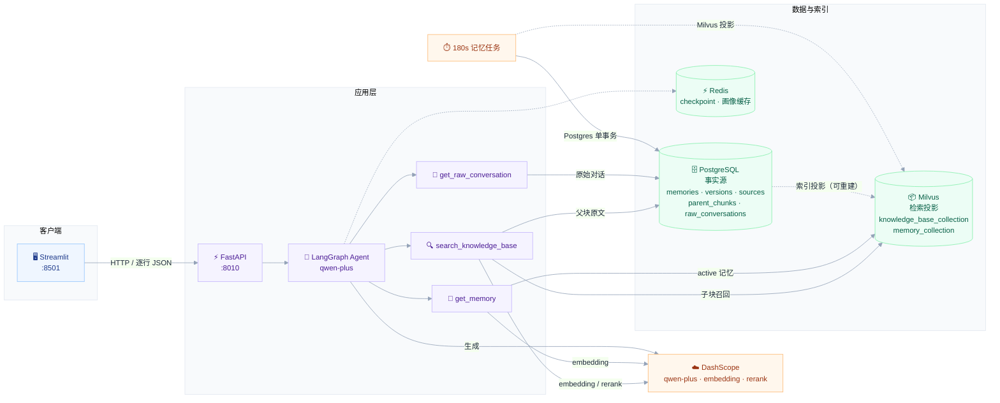

# Mnemo

> 有记忆的个性化 RAG 助手：让 AI 记住你的偏好、追溯回答来源，而不是每次对话都从零开始。

[](https://github.com/wh-violet667/Mnemo)
[](https://www.python.org/)
[](https://fastapi.tiangolo.com/)
[](https://streamlit.io/)
[](https://python.langchain.com/)
[](https://langchain-ai.github.io/langgraph/)
[](https://milvus.io/)
[](https://www.postgresql.org/)
[](https://redis.io/)
[](LICENSE)


*演示数据：`violet-kb` 中的 12 份 DOCX；记忆抽屉展示演示环境中的 17 条长期记忆（种子 + 自动抽取）。*

## 这个项目解决什么

普通 RAG 问答有两个常见问题：

1. **聊过就忘**：每次对话都重新检索，不知道用户上次说过什么偏好。
2. **答了但不可信**：回答看起来很流畅，却指不出信息来自哪份文档。

Mnemo 围绕这两点做了四件事：

- **长期记忆**：摘要、语义、情节、程序四类记忆 + 用户画像，后台定时压缩对话并提取；右侧记忆抽屉可查看分类、刷新和删除。
- **可追溯检索**：父子块 + BM25/稠密混合检索 + RRF + `qwen3-rerank`，回答用 `[1]` 标注来源；引用编号可跳转，来源卡片可展开。
- **可交互流式**：回答生成过程中可停止，完成后可复制、重新生成；失败或停止后可重试。
- **多会话隔离**：每个会话独立 Redis checkpoint，刷新/切换会话不会串上下文。

## 可验证的结果

50 条 violet 语料问题的检索评测（`violet-kb`，12 份 DOCX，k=5）：

| 模式 | Recall@5 | MRR | P50 | P95 |
|---|---:|---:|---:|---:|
| baseline（hybrid+rerank） | 1.000 | 0.832 | 2208 ms | 2457 ms |
| fast | 1.000 | 0.849 | 2261 ms | 2620 ms |
| deep | 1.000 | 0.845 | 7783 ms | 12193 ms |
| auto | 1.000 | 0.849 | 2302 ms | 8371 ms |

- Recall@5 在这套语料上已经饱和，差异主要体现在 **MRR**。
- `fast` 的 MRR 略高于 baseline，但 **deep / auto 没有继续提升**；deep 的 P95 约 12 秒，auto 约 8 秒，约为 fast 的 4–5 倍。
- 因此当前 Agentic-lite 的价值是**可控的多轮轨迹和可观测性**，不是已经被数据证明的质量提升。
- 当前默认模式是 `fast`；需要多轮反思时显式选择 `auto` 或 `deep`。
- violet 的标签是文档级（命中该文件任意父块即判对），MRR/Recall 偏乐观；答案级指标见下节。

### 答案评测

56 条（46 可回答 + 10 不可回答），`violet-kb` / `fast` / `top_k=5`，Judge 使用 `qwen-plus`：

| 指标 | 结果 |
|---|---:|
| 完全正确率 | 93.5%（43/46） |
| 忠实度（strict） | 97.6% |
| 引用有效率 / 精确率 / 覆盖率 | 98.8% / 98.0% / 94.3% |
| Chunk 支持率 | 78.1% |
| 拒答准确率 | 100%（10/10） |
| 误拒率 | 4.3%（2/46） |
| Hit@5（重建上下文） | 95.7% |
| ExpectedContextCoverage | 86.2% |
| P50 / P95 | 8.9s / 16.5s |

3 条失败样本：`v-q007`、`v-q008` 误拒，`v-q033` 把“外传在剧场版之前”答成“无直接先后顺序”。完整指标和低分样本见 [`docs/answer-eval-report.md`](docs/answer-eval-report.md)，12 条人工抽检表见 [`docs/answer-eval-human-review.csv`](docs/answer-eval-human-review.csv)（待人工填写）。

每次检索/答案评测还会写 `_meta.json`：KB 文件指纹 + 代码版本 + chunk 配置 + 模型名 + `top_k`。同一 `--run-id` 续跑时，身份不一致会直接拒绝，避免把两次不同实验拼成一个 run。

复现方式见 [检索评测](#检索评测) 和 [答案评测](#答案评测)。

## 架构



**一次对话的链路**

1. Streamlit 以逐行 JSON 读取 `/chat_with_agent/stream`，事件类型为 `status` / `answer` / `trace` / `sources` / `error`。
2. FastAPI 调用 LangGraph Agent，工具按需检索知识库和长期记忆。
3. `search_knowledge_base` 根据 `retrieval_mode` 执行一次 fast 检索，或 1-2 轮 Plan/Retrieve/Critique/Refine；检索在 Milvus 做子块召回，回 PostgreSQL 取父块原文，再统一 rerank。
4. `trace` 事件记录模式、轮次、证据数、记忆使用和耗时；回答里的 `[n]` 与 `sources` 事件对应，前端渲染来源卡片。来源卡片带支持该 claim 的 `quote` 和段落定位 `locator`，不是父块开头的截断。
5. 对话通过 BackgroundTask 写入 PostgreSQL；每 180 秒的后台任务负责压缩和提取记忆。

**数据层分工**

| 存储 | 内容 |
|---|---|
| PostgreSQL | 记忆事实源（memories / memory_versions / memory_sources / summaries）、用户、知识库、文件、父块、原始对话、会话 |
| Milvus | 知识库子块向量、BM25 稀疏向量、记忆检索投影（可由 PostgreSQL 重建） |
| Redis | LangGraph checkpoint、用户画像缓存 |
| DashScope | 对话模型、embedding、rerank |

## 关键设计

### 父子块检索

- 父块 1000 字符，子块 200 字符；子块负责召回，父块负责给模型足够上下文。
- 子块入 Milvus，父块入 PostgreSQL；命中子块后按 `parent_id` 回表取原文。
- 代价是两库关联和更多查询；收益是召回精度和上下文完整性。
- 子块按文件保留，不做跨文件共享；重复内容会多占一些向量空间，但删除旧文件不会让其他文件出现检索空洞。
- 文档处理状态为 `processing / ready / failed`；失败会保留错误信息，删除该文件后可重新上传。

### 混合检索 + RRF + rerank

- BM25 负责专有名词、编号、精确匹配；稠密向量负责语义改写。
- RRF 融合两路结果，避免分数尺度不一致。
- `qwen3-rerank` 对父块做二次排序；失败时降级为 RRF 顺序，不阻断回答。
- 评测显示 rerank 主要提升 MRR，不提升已经饱和的 Recall@5。

### 四类记忆

| 类型 | 内容 |
|---|---|
| 摘要 | 一段对话的浓缩总结 |
| 语义 | 稳定事实、偏好、背景 |
| 情节 | 具体事件、任务、历史互动 |
| 程序 | 可复用的方法、流程、步骤 |

- 记忆写入前做相似度冲突检测（≥0.9 触发 supersede），用户画像新旧融合。
- 检索打分：语义相似度 45% + 时近性 25% + 重要性 30%，再乘类型权重。

### 记忆数据模型

PostgreSQL 是记忆的事实源，Milvus 只保存可重建的检索投影：

```text
summaries          一次压缩批次的摘要正文
memories           当前记忆事实（active / superseded / deleted）
memory_versions    记忆版本历史（valid_from / valid_to / superseded_by）
memory_sources     记忆到原始消息的来源链
```

Milvus 投影仍保留 `content`，因为 BM25 稀疏向量由它生成；但 `content` 的事实副本在 PostgreSQL，Milvus 可以随时重建。

写入顺序：

1. 新记忆先和旧记忆做向量候选召回；
2. 相似度 ≥0.9 时，旧记忆标记 `superseded`，新记忆标记 `active`，不删除旧内容；
3. 在同一个 PostgreSQL 事务里写 summary、memory、version、source、消息 `summary_id` 和用户画像；
4. 事务提交后，再把新记忆和旧记忆状态投影到 Milvus；失败时标记 `index_status=failed`，用 reindex 修复。

从旧版 `memory_collection`（`auto_id=True`）升级：

```powershell
cd backend
..\.venv\Scripts\python.exe migrate_memory_v2.py
```

已迁移但 Milvus 投影丢失或需要换 embedding 模型时：

```powershell
cd backend
..\.venv\Scripts\python.exe reindex_memories.py --rebuild
```
- 后台任务每 180 秒检查未压缩对话，超过 token 阈值（默认 400 tokens）才提取，避免每轮对话都调用 LLM；所以短对话不会立即增加记忆条数。

### 会话与引用

- `thread_id = user_id:conversation_id`，不同会话的 Redis checkpoint 完全隔离。
- 会话表记录标题和最近使用的知识库，刷新后可以恢复。
- 回答只下发被 `[n]` 引用的来源，避免把 top-k 无关文档全部塞给用户；来源随消息落库，刷新后仍能显示。

### 检索模式（fast / auto / deep）

Agentic-lite：多轮反思封装在 `search_knowledge_base` 工具内部，对 Agent 仍是一次调用。

| 模式 | 行为 | 适用 |
|---|---|---|
| `fast`（默认） | 一次 hybrid + 统一 rerank，绝不升级 | 简单单跳、追求低延迟 |
| `auto` | 规则命中复杂特征走 deep；否则先 fast，0 父块时在请求内升级一次 deep | 需要自动分流时 |
| `deep` | Plan → Retrieve → Critique → Refine，最多 2 轮，统一 rerank 一次 | 比较/版本/多实体等复杂问题 |

- 轮次/预算上限与开关由环境变量控制：`AGENTIC_ENABLED`（false 时 deep/auto 降级 fast）、`AGENTIC_DEFAULT_MODE`（默认 fast）、`AGENTIC_MAX_ROUNDS`（默认 2，上限 3）、`AGENTIC_TIMEOUT_MS`（默认 12000）、`AGENTIC_MAX_QUERIES`（默认 3）。
- planner / critic 使用 `SUMMARIZATION_MODEL`（低成本），不让主模型三次调用。
- 每次检索附 `trace` 流式事件（模式、轮次、证据数、耗时），前端回答下方展示"本次：深入 · 2 轮 · 8 条证据"；旧前端忽略该事件也能正常工作。
- 达到轮次或预算上限时仍返回已有证据并提示"证据可能不足"，不会返回空答案。
- 当前实测没有观察到 deep / auto 的 Recall/MRR 增益，详见上面的 [Agentic-lite 本地实测](#agentic-lite-本地实测)；`fast` 仍是延迟最低的路径。
- 完整设计、预算和接口契约见 [`docs/phase1-agentic-lite.md`](docs/phase1-agentic-lite.md)。

## 快速开始

```bash
git clone https://github.com/wh-violet667/Mnemo.git
cd Mnemo
```

### 0. 前置条件

- Python 3.12+
- Docker（用于 PostgreSQL 16 和 Redis Stack）
- DashScope API Key（对话、embedding、rerank）
- Milvus：推荐 Zilliz Cloud 免费集群；也可以自建 Milvus

> Redis 必须是 **Redis Stack**，普通 Redis 没有 RedisJSON/RediSearch，LangGraph checkpointer 无法正常工作。

### 1. 启动 PostgreSQL 和 Redis

```bash
docker compose up -d
docker compose ps
```

默认端口：PostgreSQL `5432`，Redis `6379`。数据库名 `mnemo_db`，用户名/密码均为 `mnemo`。

### 2. 创建 Python 环境

```bash
uv venv .venv

# Windows
uv pip install --python .venv\Scripts\python.exe -r requirements.txt

# Linux / macOS
uv pip install --python .venv/bin/python -r requirements.txt
```

没有 `uv` 也可以：

```bash
python -m venv .venv
.venv\Scripts\activate        # Windows
# source .venv/bin/activate   # Linux / macOS
pip install -r requirements.txt
```

### 3. 配置 `.env`

```bash
# Windows
copy .env.docker.example .env

# Linux / macOS
cp .env.docker.example .env
```

至少填写：

```env
DASHSCOPE_API_KEY=sk-...
AGENT_BASE_MODEL=qwen-plus
AGENT_TOP_K=5
AGENT_TEMPERATURE=0.7
SUMMARIZATION_MODEL=qwen-plus
EMBEDDING_MODEL=text-embedding-v4
RERANK_MODEL=qwen3-rerank
Milvus_url=https://in03-xxxx.serverless.ali-cn-hangzhou.cloud.zilliz.com.cn
Token=...

# Agentic-lite（可选；默认 fast）
AGENTIC_ENABLED=true
AGENTIC_DEFAULT_MODE=fast
AGENTIC_MAX_ROUNDS=2
AGENTIC_TIMEOUT_MS=12000
AGENTIC_MAX_QUERIES=3
```

`Token` 是 Zilliz API Key，或 `用户名:密码`。本地无认证 Milvus 可以留空。

`SUMMARIZATION_MODEL` 只用于后台记忆抽取；`qwen-turbo` 更便宜，`qwen-plus` 的 JSON 输出更稳定，遇到限流或解析失败时可以切换。

### 4. 启动后端

```powershell
cd backend
$env:PORT=8010
..\.venv\Scripts\python.exe main.py
```

Linux / macOS：

```bash
cd backend
PORT=8010 ../.venv/bin/python main.py
```

> 8000 端口被其他软件占用时，用 8010。代码优先从 `DATABASE_URL` 解析 PostgreSQL 连接，避免 Windows 下 `PORT` 和 `port` 环境变量冲突。

### 5. 启动前端

```powershell
$env:MNEMO_API_BASE_URL="http://127.0.0.1:8010"
.\.venv\Scripts\python.exe -m streamlit run frontend\app.py --server.port 8501
```

打开 http://localhost:8501，API 文档在 http://localhost:8010/docs。

## 使用流程

1. 创建一个知识库。
2. 上传 PDF / DOCX，等待后台解析、分块、向量化；文件状态会显示 `processing / ready / failed`。
3. 选择知识库和检索模式（快速 / 自动 / 深入），提问。
4. 回答下方显示本次执行摘要（模式 / 轮次 / 证据数 / 记忆使用 / 耗时）；点击 `[1]` 跳到来源卡片，卡片显示支持该 claim 的 quote 和段落定位，可展开/收起。
5. 新建/切换会话，验证上下文隔离；会话右侧 `⋯` 可重命名。
6. 点侧栏「记忆」打开右侧抽屉，按语义/情节/程序/摘要筛选，或删除某条记忆；窄屏下是覆盖式抽屉，关闭后回到对话。
7. 知识库文件超过 12 个时，点「查看全部」展开完整列表。

## API

| 分组 | 端点 |
|---|---|
| 对话 | `GET /chat_with_agent/stream`（支持 `retrieval_mode=auto/fast/deep`、`top_k=1..50`） |
| 运行时 | `GET /runtime`（评测溯源：代码版本、模型、chunk 配置；不含密钥） |
| 知识库 | `POST/GET /knowledge-bases`、`DELETE /knowledge-bases/{id}` |
| 文件 | `POST /document_upload`、`GET /knowledge-bases/{id}/files`、`DELETE /knowledge-bases/{id}/documents/{hash}` |
| 会话 | `POST/GET /conversations`、`PATCH/DELETE /conversations/{id}`、`PATCH /conversations/{id}/knowledge-base`、`DELETE /conversations/{id}/last-turn`、`GET /conversations/{id}/messages` |
| 记忆 | `GET /memories?user_id=1&memory_type=semantic`、`DELETE /memories/{id}?user_id=1` |

流式返回示例：

```json
{"type":"status","content":"正在检索知识库..."}
{"type":"trace","content":{"mode":"deep","rounds":2,"parent_count":8,"elapsed_ms":4200,"escalated":false,"degraded":false}}
{"type":"answer","content":"退款期限是 30 天 [1]。"}
{"type":"sources","content":[{"index":1,"file_name":"refund_policy.pdf"}]}
```

## 检索评测

评测统一使用 `evals/golden_violet.jsonl`：50 条问题，对应 `violet-kb`（12 份 DOCX，默认放在本地 `data/violet-evergarden-kb/`，不提交到 Git）。题型包括 31 条单跳、7 条多跳、4 条数值、4 条不可回答、2 条版本冲突、2 条别名。

```bash
# 0. 只校验评测集格式
python evals/run_eval.py --check-only

# 1. 检查并上传本地语料（默认 data/violet-evergarden-kb）
python evals/seed_violet_kb.py --check-only
python evals/seed_violet_kb.py --base-url http://127.0.0.1:8010

# 也可以用 --corpus-dir 或 VIOLET_KB_DIR 指定其他位置
python evals/seed_violet_kb.py --corpus-dir data/violet-evergarden-kb

# 2. 检索模式 A/B
python evals/run_eval.py --retrieval-mode fast
python evals/run_eval.py --retrieval-mode deep
python evals/run_eval.py --retrieval-mode auto
python evals/run_eval.py --retrieval-mode baseline --mode hybrid+rerank
```

输出 Recall@5、MRR、P50/P95、分题型指标和未命中样本。完整语料不提交到公开仓库，放置说明见 [`data/README.md`](data/README.md)，评测细节见 [`evals/README.md`](evals/README.md)。

> violet 的标签是文档级：命中 `expected_files` 中任意文件的任意父块即判对，指标偏乐观。答案正确性、忠实度和引用支持率由单独的答案评测补齐。

## 答案评测

`evals/answer_eval.py` 调用真实 `/chat_with_agent/stream`，默认 `fast` / `top_k=5` / `violet-kb`。它把答案拆成两层判断：

- **Judge A**：对照 `reference_answer` / `required_facts` 判 0/1/2 分；
- **Judge B**：对照检索上下文判 claim 忠实度，并检查 `[n]` 引用是否有效、是否支持对应 claim。

```bash
# 3 条 pilot
python evals/answer_eval.py --limit 3

# 完整 50 条 + 6 条补充拒答
python evals/answer_eval.py --run-id full

# 断点续跑；只重跑 judge；只跑生成、不调用 judge
python evals/answer_eval.py --run-id full --resume
python evals/answer_eval.py --run-id full --rejudge
python evals/answer_eval.py --no-judge --limit 10
```

输出 `answer_violet_<run_id>.jsonl`、summary、report 和人工抽检 CSV 到 `evals/results/`。指标包括 Fully Correct Rate、Faithfulness、Citation Precision / Coverage / Chunk Support、Refusal Accuracy、ExpectedContextCoverage 和 `Correctness | hit/miss`。方法与边界见 [`docs/answer-eval.md`](docs/answer-eval.md)。

> 答案评测中的 Hit@5 基于 trace 查询重建的上下文，只作诊断；官方检索指标仍以 `run_eval.py` 为准。

## 测试

```bash
python -m pytest -q
```

当前 70 个测试（含参数化），覆盖：

- 引用编号、来源格式化、rerank 结果映射
- Recall@k / MRR / 分位数
- 会话 ID 校验、thread ID 生成、标题生成
- 记忆 supersede 候选选择
- `fast / deep / auto` 路由规则
- fake retriever / critic 的检索管线（轮次、预算、升级、编号）

Agentic planner / critic 的真实模型冒烟：

```bash
python scripts/smoke_agentic.py
```

## 项目结构

```text
Mnemo/
├── backend/
│   ├── agent.py                 # LangGraph Agent、流式输出、checkpoint
│   ├── api.py                   # FastAPI 路由
│   ├── tools.py                 # 知识库/记忆/原始对话工具
│   ├── citations.py             # 引用编号与来源格式化
│   ├── conversations.py         # 会话 ID、thread ID、标题工具
│   ├── knowledge_base_manager.py# 父子块、混合检索、删除
│   ├── retrieval.py             # Agentic-lite：fast / deep / auto 检索管线
│   ├── routing.py               # 复杂度规则、查询生成、停止条件
│   ├── memory_manager.py        # 记忆检索、supersede 判定、Milvus 投影
│   ├── auto_store_memory_from_psql.py  # 180s 记忆压缩任务
│   ├── migrate_memory_v2.py     # 旧 memory_collection 迁移脚本
│   ├── reindex_memories.py      # 从 PostgreSQL 重建 Milvus 记忆投影
│   ├── documents_process.py     # PDF/Word 解析、分块、rerank
│   ├── milvus_client.py         # Milvus 客户端与代理
│   ├── postgresql_client.py     # PostgreSQL 客户端、表结构与记忆事务
│   ├── redis_cache.py           # Redis 客户端
│   ├── runtime_identity.py      # 评测溯源：代码版本、模型、chunk 配置
│   ├── settings.py              # 启动前环境变量校验
│   └── main.py                  # 应用入口
├── frontend/
│   ├── app.py                   # Streamlit 界面：对话 + 记忆抽屉
│   └── streaming.py             # 后台流式读取与停止控制
├── assets/                      # README 截图
├── docs/
│   ├── answer-eval.md            # 答案评测方法、指标与报告说明
│   ├── answer-eval-report.md     # 56 条答案评测报告
│   ├── answer-eval-summary.json  # 答案评测聚合指标
│   ├── answer-eval-human-review.csv # 12 条人工抽检表
│   └── phase1-agentic-lite.md   # Agentic-lite 设计与实现文档
├── data/
│   ├── README.md                # 本地语料说明
│   └── violet-evergarden-kb/    # 本地语料，.gitignore 忽略
├── evals/
│   ├── build_violet_golden.py   # 转换 violet benchmark
│   ├── seed_violet_kb.py        # 上传 12 份 DOCX 到 violet-kb
│   ├── golden_violet.jsonl      # 50 条评测问题
│   ├── unanswerable_violet.jsonl # 6 条补充拒答题
│   ├── run_eval.py              # 检索层 baseline/fast/deep/auto
│   ├── answer_eval.py           # 端到端答案评测 runner
│   ├── answer_metrics.py        # 确定性指标
│   ├── judges.py                # Judge A/B 提示词与解析
│   ├── run_identity.py          # KB 指纹 + 运行身份（meta.json）
│   └── README.md
├── tests/                       # pytest（70 个测试）
├── scripts/                     # WSL/Docker 安装、Agentic 冒烟
│   ├── 01-enable-wsl.*
│   ├── 02-install-docker.ps1
│   └── smoke_agentic.py
├── docker-compose.yml           # PostgreSQL + Redis Stack
├── .env.docker.example          # 环境变量模板
└── LICENSE
```

## 已知限制

- **单用户演示**：`MNEMO_USER_ID` 默认 1，没有登录和租户隔离，不能直接公开部署。
- **评测集依赖本地语料**：50 条问题对应 12 份 DOCX，默认放在 `data/violet-evergarden-kb/`（不提交），可用 `--corpus-dir` / `VIOLET_KB_DIR` 指定；标签是文档级，MRR/Recall 偏乐观。
- **Agentic 未显示质量增益**：在 violet 50 条上，deep / auto 没有提升 Recall 或 MRR，P95 反而增加约 4-5 倍；默认已改为 `fast`，需要多轮时显式选择 `auto` / `deep`。
- **答案评测依赖 LLM judge**：Judge A/B 默认同为 `qwen-plus`，存在自偏好风险；`human_review.csv` 提供 12 条分层样本，正式结论前需要人工抽检或用 `--judge-model` 交叉验证。
- **路由仍有误判**：`auto` 在 violet 50 条中有 2 条单跳问题被路由到 deep；需要更多路由测试集再调规则。
- **没有 CI**：目前依靠本地 pytest 和手动评测，没有 GitHub Actions 门禁。
- **前端仍以单文件为主**：请求流已拆到 `frontend/streaming.py`，但 `frontend/app.py` 仍承担约 1660 行 UI/CSS/状态，后续应继续拆分组件与状态。
- **rerank 有延迟成本**：`qwen3-rerank` 会增加一次远程重排调用，适合对排序质量敏感的场景。
- **依赖外部服务**：DashScope 和 Zilliz 都是云服务，离线环境需要替换为本地模型/本地 Milvus。
- **索引是最终一致**：PostgreSQL 事务提交后若 Milvus 投影失败，需要运行 `reindex_memories.py`；尚未实现自动 outbox worker。
- **冲突策略仍是阈值式**：≥0.9 会把旧记忆标记为 superseded，尚未接入 LLM 判断 ADD / UPDATE / NOOP；相似但不同的事实可能被误替换。

## Roadmap

- [ ] 登录与用户隔离，去掉写死的 `MNEMO_USER_ID`
- [x] 记忆抽屉：查看、刷新、删除四类记忆
- [x] 记忆事实源、版本历史、来源链与 supersede
- [x] Agentic-lite：fast / auto / deep + trace；答案评测 + 70 个测试
- [x] 默认检索模式改为 `fast`，需要多轮时显式选择
- [x] 答案评测：FactualCorrectness / Faithfulness / Citation / Refusal（violet 50 + 6 拒答）
- [ ] 人工抽检 12–15 条并复核 Judge A/B
- [ ] Agentic 评测升级：更难多跳集、critic 调优
- [ ] 继续评估 `auto` 路由，若收益不足保持 `fast` 默认
- [ ] 记忆 outbox：自动重试 Milvus 投影失败
- [ ] LLM 冲突裁决：区分 ADD / UPDATE / NOOP
- [ ] 记忆纠正：手动编辑内容或标记为过期
- [ ] 文档 `status=current/archived` 元数据过滤，解决版本区分
- [ ] GitHub Actions：ruff + pytest + eval 格式检查
- [ ] 应用 Dockerfile / compose 一键启动
- [ ] 分块策略消融（chunk size / overlap）+ 答案评测复跑
- [ ] 拆分 `frontend/app.py`


