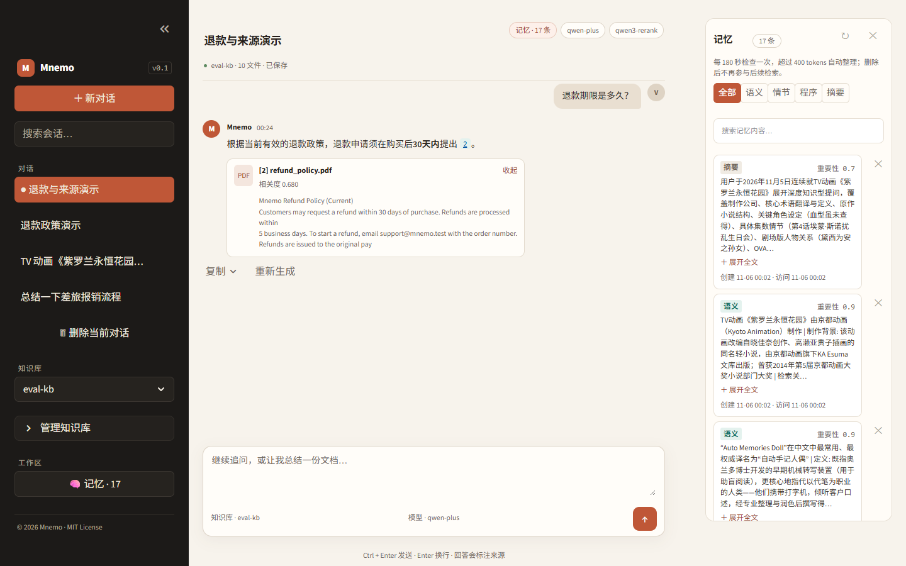
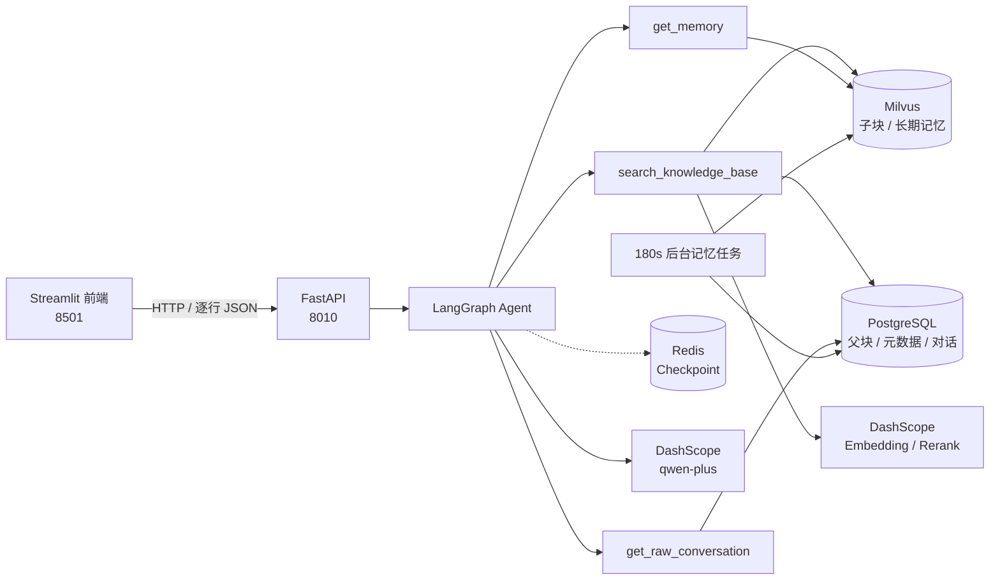

# Mnemo

> 有记忆的个性化 RAG 助手：让 AI 记住你的偏好、追溯回答来源，而不是每次对话都从零开始。

[](https://github.com/wh-violet667/Mnemo)
[](https://www.python.org/)
[](https://fastapi.tiangolo.com/)
[](https://streamlit.io/)
[](https://python.langchain.com/)
[](https://langchain-ai.github.io/langgraph/)
[](https://milvus.io/)
[](https://www.postgresql.org/)
[](https://redis.io/)
[](LICENSE)



*演示数据：`eval-kb` 中的 10 份合成 PDF，以及 17 条长期记忆（5 条种子 + 12 条自动抽取）。*

## 这个项目解决什么

普通 RAG 问答有两个常见问题：

1. **聊过就忘**：每次对话都重新检索，不知道用户上次说过什么偏好。
2. **答了但不可信**：回答看起来很流畅，却指不出信息来自哪份文档。

Mnemo 围绕这两点做了四件事：

- **长期记忆**：摘要、语义、情节、程序四类记忆 + 用户画像，后台定时压缩对话并提取；右侧记忆抽屉可查看分类、刷新和删除。
- **可追溯检索**：父子块 + BM25/稠密混合检索 + RRF + `qwen3-rerank`，回答用 `[1]` 标注来源；引用编号可跳转，来源卡片可展开。
- **可交互流式**：回答生成过程中可停止，完成后可复制、重新生成；失败或停止后可重试。
- **多会话隔离**：每个会话独立 Redis checkpoint，刷新/切换会话不会串上下文。

## 可验证的结果

30 条问题的检索评测（10 份合成 PDF，含现行/过时版本干扰文档）：

| 检索策略 | Recall@5 | MRR | P95 延迟 |
|---|---|---|---|
| 仅稠密向量 | 1.000 | 0.867 | 1212 ms |
| 稠密 + BM25 + RRF | 1.000 | 0.867 | 1292 ms |
| 再加 `qwen3-rerank` | 1.000 | **0.933** | 2525 ms |

- 召回在这套语料上已经饱和，rerank 的收益主要在 **MRR**：把正确文档排到第 1。
- 代价是约 1 秒延迟；因此 rerank 是可选策略，不是无脑默认。
- 剩余错误集中在「现行 vs 过时版本」：两类文档都包含查询里的数字，rerank 无法稳定判断。下一步应使用 `status=current/archived` 元数据过滤，而不是继续调 rerank。

复现方式见 [检索评测](#检索评测)。

## 架构



**一次对话的链路**

1. Streamlit 以逐行 JSON 读取 `/chat_with_agent/stream`，事件类型为 `status` / `answer` / `sources` / `error`。
2. FastAPI 调用 LangGraph Agent，工具按需检索知识库和长期记忆。
3. 检索在 Milvus 做子块召回，回 PostgreSQL 取父块原文，再 rerank。
4. 回答里的 `[n]` 与 `sources` 事件对应，前端渲染来源卡片。
5. 对话通过 BackgroundTask 写入 PostgreSQL；每 180 秒的后台任务负责压缩和提取记忆。

**数据层分工**

| 存储 | 内容 |
|---|---|
| PostgreSQL | 记忆事实源（memories / memory_versions / memory_sources / summaries）、用户、知识库、文件、父块、原始对话、会话 |
| Milvus | 知识库子块向量、BM25 稀疏向量、记忆检索投影（可由 PostgreSQL 重建） |
| Redis | LangGraph checkpoint、用户画像缓存 |
| DashScope | 对话模型、embedding、rerank |

## 关键设计

### 父子块检索

- 父块 1000 字符，子块 200 字符；子块负责召回，父块负责给模型足够上下文。
- 子块入 Milvus，父块入 PostgreSQL；命中子块后按 `parent_id` 回表取原文。
- 代价是两库关联和更多查询；收益是召回精度和上下文完整性。

### 混合检索 + RRF + rerank

- BM25 负责专有名词、编号、精确匹配；稠密向量负责语义改写。
- RRF 融合两路结果，避免分数尺度不一致。
- `qwen3-rerank` 对父块做二次排序；失败时降级为 RRF 顺序，不阻断回答。
- 评测显示 rerank 主要提升 MRR，不提升已经饱和的 Recall@5。

### 四类记忆

| 类型 | 内容 |
|---|---|
| 摘要 | 一段对话的浓缩总结 |
| 语义 | 稳定事实、偏好、背景 |
| 情节 | 具体事件、任务、历史互动 |
| 程序 | 可复用的方法、流程、步骤 |

- 记忆写入前做相似度冲突检测（≥0.9 触发 supersede），用户画像新旧融合。
- 检索打分：语义相似度 45% + 时近性 25% + 重要性 30%，再乘类型权重。

### 记忆数据模型

PostgreSQL 是记忆的事实源，Milvus 只保存可重建的检索投影：

```text
summaries          一次压缩批次的摘要正文
memories           当前记忆事实（active / superseded / deleted）
memory_versions    记忆版本历史（valid_from / valid_to / superseded_by）
memory_sources     记忆到原始消息的来源链
```

Milvus 投影仍保留 `content`，因为 BM25 稀疏向量由它生成；但 `content` 的事实副本在 PostgreSQL，Milvus 可以随时重建。

写入顺序：

1. 新记忆先和旧记忆做向量候选召回；
2. 相似度 ≥0.9 时，旧记忆标记 `superseded`，新记忆标记 `active`，不删除旧内容；
3. 在同一个 PostgreSQL 事务里写 summary、memory、version、source、消息 `summary_id` 和用户画像；
4. 事务提交后，再把新记忆和旧记忆状态投影到 Milvus；失败时标记 `index_status=failed`，用 reindex 修复。

从旧版 `memory_collection`（`auto_id=True`）升级：

```powershell
cd backend
..\.venv\Scripts\python.exe migrate_memory_v2.py
```

已迁移但 Milvus 投影丢失或需要换 embedding 模型时：

```powershell
cd backend
..\.venv\Scripts\python.exe reindex_memories.py --rebuild
```
- 后台任务每 180 秒检查未压缩对话，超过 token 阈值（默认 400 tokens）才提取，避免每轮对话都调用 LLM；所以短对话不会立即增加记忆条数。

### 会话与引用

- `thread_id = user_id:conversation_id`，不同会话的 Redis checkpoint 完全隔离。
- 会话表记录标题和最近使用的知识库，刷新后可以恢复。
- 回答只下发被 `[n]` 引用的来源，避免把 top-k 无关文档全部塞给用户；来源随消息落库，刷新后仍能显示。

## 快速开始

```bash
git clone https://github.com/wh-violet667/Mnemo.git
cd Mnemo
```

### 0. 前置条件

- Python 3.12+
- Docker（用于 PostgreSQL 16 和 Redis Stack）
- DashScope API Key（对话、embedding、rerank）
- Milvus：推荐 Zilliz Cloud 免费集群；也可以自建 Milvus

> Redis 必须是 **Redis Stack**，普通 Redis 没有 RedisJSON/RediSearch，LangGraph checkpointer 无法正常工作。

### 1. 启动 PostgreSQL 和 Redis

```bash
docker compose up -d
docker compose ps
```

默认端口：PostgreSQL `5432`，Redis `6379`。数据库名 `mnemo_db`，用户名/密码均为 `mnemo`。

### 2. 创建 Python 环境

```bash
uv venv .venv

# Windows
uv pip install --python .venv\Scripts\python.exe -r requirements.txt

# Linux / macOS
uv pip install --python .venv/bin/python -r requirements.txt
```

没有 `uv` 也可以：

```bash
python -m venv .venv
.venv\Scripts\activate        # Windows
# source .venv/bin/activate   # Linux / macOS
pip install -r requirements.txt
```

### 3. 配置 `.env`

```bash
# Windows
copy .env.docker.example .env

# Linux / macOS
cp .env.docker.example .env
```

至少填写：

```env
DASHSCOPE_API_KEY=sk-...
AGENT_BASE_MODEL=qwen-plus
SUMMARIZATION_MODEL=qwen-plus
EMBEDDING_MODEL=text-embedding-v4
RERANK_MODEL=qwen3-rerank
Milvus_url=https://in03-xxxx.serverless.ali-cn-hangzhou.cloud.zilliz.com.cn
Token=...
```

`Token` 是 Zilliz API Key，或 `用户名:密码`。本地无认证 Milvus 可以留空。

`SUMMARIZATION_MODEL` 只用于后台记忆抽取；`qwen-turbo` 更便宜，`qwen-plus` 的 JSON 输出更稳定，遇到限流或解析失败时可以切换。

### 4. 启动后端

```powershell
cd backend
$env:PORT=8010
..\.venv\Scripts\python.exe main.py
```

Linux / macOS：

```bash
cd backend
PORT=8010 ../.venv/bin/python main.py
```

> 8000 端口被其他软件占用时，用 8010。代码优先从 `DATABASE_URL` 解析 PostgreSQL 连接，避免 Windows 下 `PORT` 和 `port` 环境变量冲突。

### 5. 启动前端

```powershell
$env:MNEMO_API_BASE_URL="http://127.0.0.1:8010"
.\.venv\Scripts\python.exe -m streamlit run frontend\app.py --server.port 8501
```

打开 http://localhost:8501，API 文档在 http://localhost:8010/docs。

## 使用流程

1. 创建一个知识库。
2. 上传 PDF / DOCX，等待后台解析、分块、向量化。
3. 选择知识库，提问。
4. 点击回答里的 `[1]` 跳到下方来源卡片；来源卡片可展开/收起。
5. 新建/切换会话，验证上下文隔离。
6. 点侧栏「记忆」打开右侧抽屉，按语义/情节/程序/摘要筛选，或删除某条记忆。

## API

| 分组 | 端点 |
|---|---|
| 对话 | `GET /chat_with_agent/stream` |
| 知识库 | `POST/GET /knowledge-bases`、`DELETE /knowledge-bases/{id}` |
| 文件 | `POST /document_upload`、`GET /knowledge-bases/{id}/files`、`DELETE /knowledge-bases/{id}/documents/{hash}` |
| 会话 | `POST/GET /conversations`、`PATCH/DELETE /conversations/{id}`、`PATCH /conversations/{id}/knowledge-base`、`DELETE /conversations/{id}/last-turn`、`GET /conversations/{id}/messages` |
| 记忆 | `GET /memories?user_id=1&memory_type=semantic`、`DELETE /memories/{id}?user_id=1` |

流式返回示例：

```json
{"type":"status","content":"正在检索知识库..."}
{"type":"answer","content":"退款期限是 30 天 [1]。"}
{"type":"sources","content":[{"index":1,"file_name":"refund_policy.pdf"}]}
```

## 检索评测

评测语料是 10 份 PDF：5 份现行制度 + 5 份过时/区域/承包商版本作为干扰；共 30 条问题，包含版本区分题。

```bash
# 1. 生成语料
python evals/build_corpus.py

# 2. 上传到正在运行的后端
python evals/seed_eval_kb.py --base-url http://127.0.0.1:8010

# 3. 三种检索策略
python evals/run_eval.py --kb-id eval-kb --mode dense
python evals/run_eval.py --kb-id eval-kb --mode hybrid
python evals/run_eval.py --kb-id eval-kb --mode hybrid+rerank
```

输出 Recall@5、MRR、P50/P95，以及未命中样本。详细说明见 [`evals/README.md`](evals/README.md)。

> 这是合成评测集，用于验证流水线和做消融，不代表真实业务效果。真实项目需要用业务文档重新标注 golden set。

## 测试

```bash
pytest -q
```

当前 14 个用例，覆盖：

- 引用编号、来源格式化、rerank 结果映射
- Recall@k / MRR / 分位数
- 会话 ID 校验、thread ID 生成、标题生成

## 项目结构

```text
Mnemo/
├── backend/
│   ├── agent.py                 # LangGraph Agent、流式输出、checkpoint
│   ├── api.py                   # FastAPI 路由
│   ├── tools.py                 # 知识库/记忆/原始对话工具
│   ├── citations.py             # 引用编号与来源格式化
│   ├── conversations.py         # 会话 ID、thread ID、标题工具
│   ├── knowledge_base_manager.py# 父子块、混合检索、删除
│   ├── memory_manager.py        # 记忆检索、supersede 判定、Milvus 投影
│   ├── auto_store_memory_from_psql.py  # 180s 记忆压缩任务
│   ├── migrate_memory_v2.py     # 旧 memory_collection 迁移脚本
│   ├── reindex_memories.py      # 从 PostgreSQL 重建 Milvus 记忆投影
│   ├── documents_process.py     # PDF/Word 解析、分块、rerank
│   ├── milvus_client.py         # Milvus 客户端与代理
│   ├── postgresql_client.py     # PostgreSQL 客户端、表结构与记忆事务
│   ├── redis_cache.py           # Redis 客户端
│   ├── settings.py              # 启动前环境变量校验
│   └── main.py                  # 应用入口
├── frontend/
│   ├── app.py                   # Streamlit 界面：对话 + 记忆抽屉
│   └── streaming.py             # 后台流式读取与停止控制
├── assets/                      # README 截图
├── evals/
│   ├── build_corpus.py          # 生成评测 PDF
│   ├── seed_eval_kb.py          # 上传评测语料
│   ├── golden.jsonl             # 30 条评测问题
│   ├── run_eval.py              # 三种模式评测
│   └── README.md
├── tests/                       # pytest
├── scripts/                     # Docker/WSL 安装辅助脚本
├── docker-compose.yml           # PostgreSQL + Redis Stack
├── .env.docker.example          # 环境变量模板
└── LICENSE
```

## 已知限制

- **单用户演示**：`MNEMO_USER_ID` 默认 1，没有登录和租户隔离，不能直接公开部署。
- **评测集是合成的**：30 条问题规模小，版本区分题仍然会失败；需要真实文档和更大样本。
- **没有 CI**：目前依靠本地 pytest 和手动评测，没有 GitHub Actions 门禁。
- **前端仍以单文件为主**：请求流已拆到 `frontend/streaming.py`，但 `frontend/app.py` 仍承担约 1600 行 UI/CSS/状态，后续应继续拆分组件与状态。
- **rerank 有延迟成本**：`qwen3-rerank` 带来约 1 秒 P95 增加，适合对排序质量敏感的场景。
- **依赖外部服务**：DashScope 和 Zilliz 都是云服务，离线环境需要替换为本地模型/本地 Milvus。
- **索引是最终一致**：PostgreSQL 事务提交后若 Milvus 投影失败，需要运行 `reindex_memories.py`；尚未实现自动 outbox worker。
- **冲突策略仍是阈值式**：≥0.9 会把旧记忆标记为 superseded，尚未接入 LLM 判断 ADD / UPDATE / NOOP；相似但不同的事实可能被误替换。

## Roadmap

- [ ] 登录与用户隔离，去掉写死的 `MNEMO_USER_ID`
- [x] 记忆抽屉：查看、刷新、删除四类记忆
- [x] 记忆事实源、版本历史、来源链与 supersede
- [ ] 记忆 outbox：自动重试 Milvus 投影失败
- [ ] LLM 冲突裁决：区分 ADD / UPDATE / NOOP
- [ ] 记忆纠正：手动编辑内容或标记为过期
- [ ] 文档 `status=current/archived` 元数据过滤，解决版本区分
- [ ] GitHub Actions：ruff + pytest + eval 格式检查
- [ ] 应用 Dockerfile / compose 一键启动
- [ ] 真实文档评测集 + 答案忠实度（LLM judge）
- [ ] 拆分 `frontend/app.py`


