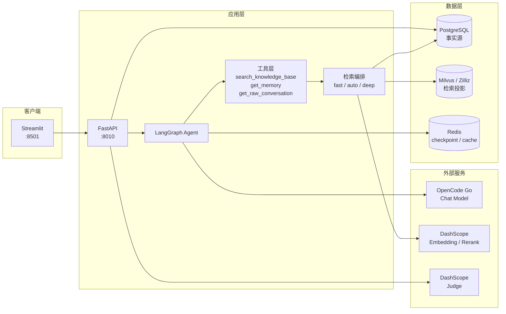
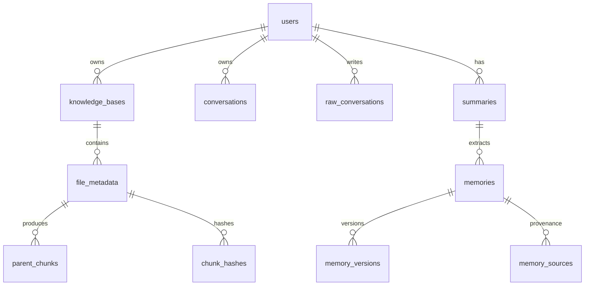
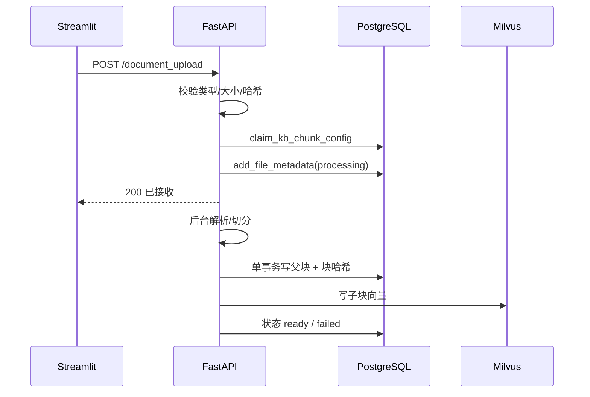
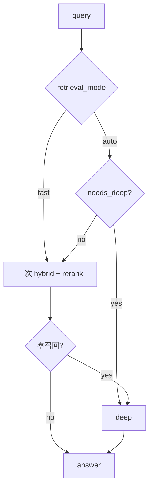

# Mnemo 项目架构文档

> 面向：二次开发、代码 review、部署运维、面试/答辩技术说明。
>
> 范围：当前仓库的 RAG、Agent、长期记忆、评测和运行方式。
>
> 事实源：以代码和 `docs/experiments.md` 为准；本文负责解释“为什么这样设计”。

---

## 1. 项目概览

Mnemo 是一个面向私有知识库的 RAG 问答系统：

- 文档进入父子块索引；
- 查询走 dense + BM25 混合检索、RRF 融合和 rerank；
- LangGraph Agent 负责工具选择、检索编排和回答生成；
- 回答带 `[n]` 引用、quote 和段落 locator；
- 历史对话被压缩成四类长期记忆；
- PostgreSQL 是事实源，Milvus 是可重建的检索投影；
- 有证据级检索评测、答案 Judge A/B 和分块策略 A/B。

### 1.1 一句话介绍

> Mnemo 把“私有文档检索、可追溯引用、长期记忆、可复现评测”放在同一条链路里，而不是只把文档丢进向量库。

### 1.2 核心目标

| 目标 | 实现 |
|---|---|
| 私有知识问答 | PDF/DOCX/Markdown 入库，hybrid 检索 + rerank |
| 回答可核验 | `[n]` 引用、source quote、paragraph locator |
| 多会话隔离 | Redis checkpoint，按 `user_id + conversation_id` |
| 长期个性化 | 四类记忆 + 用户画像 |
| 可评测 | 50 题 golden set、`gold_evidence`、答案 Judge A/B |
| 可解释边界 | trace、运行身份、负结果和限制文档 |

### 1.3 非目标

当前版本**不是**：

- 多租户生产系统：没有登录/鉴权，`user_id` 由客户端传入；
- 图记忆系统：没有 Neo4j；
- 多模态记忆：没有图片/音频索引；
- token 精确分块：仍是字符预算；
- 完整 outbox：Milvus 投影失败仍需 reindex；
- 完整记忆评测：记忆使用率在历史答案评测中是 0%。

---

## 2. 架构总览



### 2.1 分层

| 层 | 主要组件 | 职责 |
|---|---|---|
| 交互层 | `frontend/app.py`、`frontend/streaming.py` | 对话、知识库、记忆抽屉、引用卡片 |
| API 层 | `backend/api.py`、`backend/main.py` | 上传、知识库、会话、记忆、SSE |
| Agent 层 | `backend/agent.py`、`backend/tools.py` | LangGraph、工具调用、流式输出 |
| 检索层 | `backend/retrieval.py`、`routing.py`、`knowledge_base_manager.py` | fast/auto/deep、RRF、rerank |
| 文档层 | `backend/documents_process.py`、`chunking.py`、`markdown_chunking.py` | 解析、父子块、Markdown 结构 |
| 记忆层 | `backend/auto_store_memory_from_psql.py`、`memory_manager.py`、`memory_types.py` | 抽取、去重、supersede、检索 |
| 事实层 | `backend/postgresql_client.py` | 表结构、事务、版本、来源 |
| 评测层 | `evals/` | golden set、retrieval/answer metrics、实验 |

### 2.2 五条设计原则

1. **PostgreSQL 是事实源，Milvus 是可重建投影**
   - 文件状态、父块、记忆版本、来源链都在 PG；
   - Milvus 只保存检索所需的子块/记忆向量和文本；
   - 投影失败可以 reindex，不回滚事实。

2. **父子块分离**
   - 子块小，负责召回；
   - 父块大，负责给模型上下文；
   - 检索先命中子块，再按 `parent_id` 回表父块。

3. **知识库 profile 绑定**
   - 一个 KB 只能有一种 chunk 配置；
   - 第一次上传绑定，后续不匹配返回 `409`；
   - 旧 KB 没有配置则标记 `legacy-unknown`，禁止追加。

4. **受控 Agentic**
   - 外层 Agent 每轮最多调用一次知识库工具；
   - 多轮检索在工具内部由确定性状态机控制；
   - 有预算、轮次、停止条件，不让模型无限 ReAct。

5. **评测先行**
   - 检索和答案分开评；
   - 证据级标签，不用“命中正确文件”冒充正确；
   - 分块实验用配对 bootstrap CI，不只看均值。

---

## 3. 运行时拓扑

| 服务 | 地址 | 说明 |
|---|---|---|
| Streamlit | `http://127.0.0.1:8501` | 前端 |
| FastAPI | `http://127.0.0.1:8010` | API + SSE |
| PostgreSQL | `localhost:5432` | Docker |
| Redis | `localhost:6379` | Docker |
| Milvus | Zilliz Cloud | `.env` 的 `Milvus_url` / `Token` |
| Embedding/Rerank | DashScope | `text-embedding-v4` / `qwen3.7-text-rerank` |
| Chat | OpenCode Go | `AGENT_BASE_MODEL` |

### 3.1 启动

```powershell
docker compose up -d

cd backend
$env:PORT="8010"
$env:HOST="127.0.0.1"
..\.venv\Scripts\python.exe main.py
```

另开终端：

```powershell
$env:MNEMO_API_BASE_URL="http://127.0.0.1:8010"
.\.venv\Scripts\python.exe -m streamlit run frontend\app.py --server.port 8501
```

注意：

- 前端默认 API 是 `http://127.0.0.1:8000`；如果后端跑 8010，必须设置 `MNEMO_API_BASE_URL`。
- `docker-compose.yml` 只启动 PostgreSQL 和 Redis；Milvus 是云端。
- `.env.docker.example` 是 Docker 默认模板；`.env.example` 是自定义部署模板，里面的 `user:pass` 是占位符。

---

## 4. 领域模型与数据表



### 4.1 表清单

| 表 | 作用 | 关键字段 |
|---|---|---|
| `users` | 用户与画像 | `user_id`, `user_profile` |
| `conversations` | 会话 | `conversation_id`, `knowledge_base_id` |
| `knowledge_bases` | 知识库与绑定配置 | `chunk_profile`, `chunk_config` |
| `file_metadata` | 文件状态与配置 | `file_hash`, `file_name`, `status`, `error`, `chunk_profile`, `chunk_config` |
| `parent_chunks` | 父块原文 | `parent_id`, `text`, `file_hash` |
| `chunk_hashes` | 子块哈希 | `chunk_hash`, `file_hash` |
| `raw_conversations` | 原始消息 | `id`, `role`, `content`, `summary_id` |
| `summaries` | 一次记忆压缩的摘要 | `summary_id`, `content`, `importance` |
| `memories` | 当前记忆事实 | `memory_id`, `memory_type`, `confidence`, `attributes`, `event_time`, `dedupe_key`, `expires_at`, `status` |
| `memory_versions` | 记忆版本历史 | `memory_id`, `valid_from`, `valid_to`, `superseded_by` |
| `memory_sources` | 记忆到原始消息的来源链 | `memory_id`, `message_id`, `summary_id` |

### 4.2 状态机

**文件状态**：

```text
processing → ready
processing → failed
failed → processing（重新上传时）
```

**记忆状态**：

```text
active → superseded
active → deleted
active → archived（TTL）
```

`deleted` 是软删除；`archived` 是过期归档，不参与检索。

---

## 5. 文档写入链路



### 5.1 上传阶段

1. 校验扩展名：`.pdf`、`.doc`、`.docx`、`.md`。
2. 校验大小上限。
3. 流式写临时文件，同时计算 SHA-256。
4. 检查同用户、同 KB 是否已有 hash。
5. 解析 `chunk_profile` 或显式 chunk 参数。
6. `claim_kb_chunk_config()`：
   - 第一次上传绑定 profile/config；
   - 后续不匹配返回 `409`；
   - 旧库无配置返回 `legacy-unknown`。
7. 写 `file_metadata`，状态 `processing`。
8. 返回 200，后台任务继续处理。

### 5.2 处理阶段

1. 加载 PDF/DOCX/Markdown。
2. 父块切分。
3. 子块切分。
4. 每个父块生成 UUID。
5. 每个子块计算哈希，并记录：
   - `parent_id`
   - `parent_index`
   - `file_hash`
   - `file_name`
   - `knowledge_base_id`
   - `user_id`
   - Markdown 元数据（可选）
6. PostgreSQL 单事务写：
   - 父块；
   - 块哈希；
   - 文件状态。
7. 事务提交后写 Milvus。
8. 如果 Milvus 失败：
   - 文件标记 `failed`；
   - 清理 PG 半成品；
   - 用户可重新上传，API 会先清理旧投影和旧元数据。

### 5.3 分块策略

| Profile | Strategy | 父块 | 子块 | 适用 |
|---|---|---:|---:|---|
| `fine-overlap` | recursive | 1000/200 | 200/50 | 默认 |
| `coarse-no-overlap` | recursive | 1000/200 | 400/0 | 实验最佳 |
| `markdown-heading` | markdown-heading | 1000/0 | 400/0 | Markdown |

#### recursive

- `RecursiveCharacterTextSplitter`
- separators：`\n\n`、`\n`、`。`、`！`、`？`、`，`、`、`、空格、空串
- 按字符预算切分。

#### markdown-heading

- 去掉 YAML front matter。
- 按 ATX 标题建立 `heading_path`。
- 表格尽量整表保留；必须切表时重复表头。
- 代码块尽量整体保留。
- 同一一级标题下的相邻短章节合并。
- 子块记录 `heading_path`、`heading_paths`、`start`、`end`、`block_type`。
- 只接受 `.md`；overlap 固定为 0。

#### 为什么保留 200/50 默认

DOCX 实验中 `400/0` 的 Recall 更高，但：

- 只有 50 题；
- 是 child 检索层；
- 没有对每个配置跑答案级评测；
- 直接改默认有过拟合风险。

因此默认仍 `fine-overlap`，`coarse-no-overlap` 作为显式选项。

### 5.4 已知问题

- 默认 recursive 仍可能切断表格。
- 字符预算不是 token 预算。
- PDF/DOCX 没有统一转 Markdown。
- 失败文件如果进程崩溃卡在 `processing`，没有 watchdog。

---

## 6. 检索链路

### 6.1 总流程

```text
query
  → dense embedding 召回
  → BM25 稀疏召回
  → RRF 融合
  → 子块 top 候选
  → 按 parent_id 回表父块
  → rerank
  → top_k + 编号
  → 交给 Agent 生成
```

### 6.2 混合检索与 RRF

- **BM25**：专有名词、编号、精确匹配。
- **dense**：语义改写、近义表达。
- **RRF**：避免 dense 和 BM25 分数尺度不一致。
- **rerank**：对父块做二次排序，提升 MRR/证据位置。
- rerank 失败时保留 RRF 顺序，不阻断回答。

### 6.3 fast / auto / deep



| 模式 | 行为 | 默认 |
|---|---|---|
| `fast` | 一次 hybrid + rerank | 是 |
| `auto` | 规则判断 + fast 零召回升级 | 否 |
| `deep` | Plan → Retrieve → Critique → Refine，最多 2 轮 | 否 |

deep 停止条件：

- 达到 `max_rounds`；
- 没有新增 parent；
- critic 判断 `sufficient=true`；
- 预算耗尽；
- 无法生成 refine query。

### 6.4 为什么 deep 默认关闭

旧文档级 50 题实测：

- baseline / fast / deep / auto 的 Recall@5 都是 1.000；
- deep/auto 没有提升 MRR；
- deep P95 约 12 秒，fast 约 2.6 秒。

所以默认 `fast`；deep 保留给多跳、版本冲突和可观测性场景。

---

## 7. Agent 循环

### 7.1 外层：LangGraph

- `create_agent(model, tools, middleware, checkpointer)`
- 工具：
  - `search_knowledge_base`
  - `get_memory`
  - `get_raw_conversation_by_summary_id`
- 中间件：
  - `search_knowledge_base` 每轮最多 1 次；
  - `get_memory` 每轮最多 1 次；
  - `SummarizationMiddleware`：超过 10000 token 时摘要，保留最近 20 条消息。
- Redis checkpointer：60 分钟 TTL，按 `user_id + conversation_id` 隔离。

### 7.2 内层：检索状态机

`search_knowledge_base` 调用 `run_retrieval()`：

- fast：一次召回；
- auto：规则路由 + 零召回升级；
- deep：planner → 并发检索 → merge/dedupe → critic → refine。

关键限制：

- 外层不允许模型反复调用知识库工具；
- 多轮次数、预算、查询数都可控；
- 最终只做一次统一 rerank。

### 7.3 流式与引用

`agent.astream` 同时消费：

- `messages`：逐 token 回答；
- `custom`：工具状态和 trace。

结束后：

1. `enrich_sources_with_quotes` 给每个 source 绑定 quote/locator；
2. 只把回答里真正引用到的 `[n]` 发给前端；
3. 后台把 human/ai 消息、sources、trace 写入 PostgreSQL。

---

## 8. 长期记忆

### 8.1 四类记忆

| 类型 | 作用 |
|---|---|
| summary | 一次对话的压缩摘要 |
| semantic | 稳定事实/偏好 |
| episodic | 具体事件、历史互动 |
| procedural | 可复用方法、步骤 |

`user_profile` 是从 semantic/episodic 合并出的画像，不是第五类记忆。

### 8.2 写入链路

```text
每 180 秒扫描未摘要消息
  → token > 400
  → LLM 提取 summary/semantic/episodic/procedural + user_profile
  → 类型校验 + dedupe_key
  → PostgreSQL 单事务写事实/版本/来源/消息标记
  → Milvus 投影
```

最新类型化策略：

- 每条记忆带 `confidence`、`attributes`、`event_time`、`dedupe_key`、`usage_count`、`success_count/failure_count`、`expires_at`。
- 先按 `dedupe_key` 精确去重。
- 只有 semantic/procedural 做相似度 ≥0.9 的 supersede；episodic 不覆盖。
- summary TTL 30 天，episodic TTL 180 天。
- semantic/procedural 不按时间过期。

### 8.3 检索打分

| 类型 | 打分 |
|---|---|
| summary | 相关性 + 7 天半衰期 recency |
| semantic | 相关性 + confidence + importance，**不做小时级衰减** |
| episodic | 相关性 + 30 天半衰期 recency |
| procedural | 相关性 + 成功率 + 使用次数 + importance |

Milvus 只负责候选召回；命中后用 PostgreSQL 的 `get_active_memory_metadata()` 回填生命周期字段，再做类型化排序。

### 8.4 记忆与知识库边界

- 事实问题：知识库优先；
- 偏好/历史：可以查记忆；
- 记忆不能覆盖知识库；
- 记忆不参与 `[n]` 引用编号。

### 8.5 已知边界

- 没有工作记忆 TTL；
- 没有低价值记忆的主动遗忘；
- 记忆专项评测仍为 0；
- 后台任务没有跨进程锁。

---

## 9. API

| 分组 | 端点 | 说明 |
|---|---|---|
| 文档 | `POST /document_upload` | 上传并后台入库 |
| 知识库 | `POST /knowledge-bases` | 创建 KB |
| 知识库 | `GET /knowledge-bases` | 列表 |
| 知识库 | `DELETE /knowledge-bases/{id}` | 删除 KB |
| 文件 | `GET /knowledge-bases/{id}/files` | 文件状态 |
| 文件 | `DELETE /knowledge-bases/{id}/documents/{hash}` | 删除文件 |
| 分块 | `GET /knowledge-bases/{id}/chunk-config` | KB 绑定配置 |
| 分块 | `GET /chunking/profiles` | 命名策略列表 |
| 会话 | `POST/GET /conversations` | 新建/列表 |
| 会话 | `PATCH/DELETE /conversations/{id}` | 重命名/删除 |
| 会话 | `PATCH /conversations/{id}/knowledge-base` | 切换 KB |
| 会话 | `DELETE /conversations/{id}/last-turn` | 重生成前裁剪 |
| 会话 | `GET /conversations/{id}/messages` | 消息历史 |
| 记忆 | `GET /memories` | 按类型读取 active 记忆 |
| 记忆 | `DELETE /memories/{id}` | 软删除 |
| 运行时 | `GET /runtime` | 代码/模型/chunk 配置 |
| 问答 | `GET /chat_with_agent/stream` | SSE 流式回答 |

### 9.1 SSE 事件

```text
status  → 工具执行状态
trace   → 检索模式/轮次/查询/耗时
answer  → 逐 token 回答
sources → 引用来源、quote、locator
error   → 错误
```

### 9.2 常见状态码

| 状态码 | 场景 |
|---|---|
| 400 | 文件类型/大小/策略不匹配 |
| 404 | KB/文件/记忆不存在 |
| 409 | KB 已绑定其他 chunk 配置 |
| 422 | 参数/标识符非法 |
| 500 | 数据库/检索/生成错误 |

---

## 10. 配置

### 10.1 环境文件

| 文件 | 用途 |
|---|---|
| `.env.docker.example` | Docker 默认 PostgreSQL/Redis 配置 |
| `.env.example` | 自定义部署模板 |

不要把真实 `.env` 提交到 Git。

### 10.2 关键配置

```text
OPENCODE_API_KEY / BASE_URL / AGENT_BASE_MODEL
DASHSCOPE_API_KEY
EMBEDDING_MODEL / dense_dimension
RERANK_MODEL / RERANK_URL
Milvus_url / Token
DATABASE_URL / REDIS_URL
AGENT_TOP_K / AGENT_TEMPERATURE
AGENTIC_ENABLED / AGENTIC_DEFAULT_MODE /
AGENTIC_MAX_ROUNDS / AGENTIC_TIMEOUT_MS / AGENTIC_MAX_QUERIES
JUDGE_BASE_URL / JUDGE_API_KEY / JUDGE_MODEL
```

### 10.3 分块配置

```text
DEFAULT_CHUNK_PROFILE = fine-overlap
CHUNK_STRATEGIES = recursive / markdown-heading
```

`ChunkConfig` 校验：

- parent 100–8000；
- child ≥50 且 ≤parent；
- overlap < size；
- Markdown 策略 overlap 必须为 0。

---

## 11. 评测体系

### 11.1 检索评测

50 题 golden set，46 条可回答参与指标：

| 指标 | 定义 |
|---|---|
| Recall@5 | 前 5 条是否有至少一条相关（实际是 Hit Rate@5） |
| MRR | 第一条相关结果的倒数排名 |
| Precision@5 | 相关条数 / 5 |
| nDCG@5 | 二值相关性排序质量 |
| P50/P95 | 延迟 |
| best_evidence_overlap | 最好 chunk 覆盖 gold quote 的比例 |

证据判定：

- quote 是 chunk 子串 → 1.0；
- 否则字符 bigram 覆盖率 ≥ 0.55；
- 文件名按 stem 匹配。

### 11.2 答案评测

56 题（46 可回答 + 10 不可回答）：

| 指标 | 定义 |
|---|---|
| Fully Correct Rate | Judge A 给 2 分的比例 |
| Mean Correctness | score/2 均值 |
| Fact Coverage | required_facts 子串命中率 |
| Faithfulness | supported claims / total claims |
| Citation Validity | 有效 `[n]` / 全部 `[n]` |
| Citation Precision | 支持 claim 的 `[n]` / 全部 `[n]` |
| Citation Coverage | 有有效引用的 claim / 需要引用的 claim |
| Chunk Support Rate | 被引父块原文包含 quote 的比例 |
| Refusal Accuracy | 不可回答题正确拒答比例 |
| False Refusal Rate | 可回答题被误拒比例 |

历史结果（`qwen-plus`，不是当前模型）：

- 完全正确率 93.5%；
- 忠实度 97.6%；
- 引用有效率/精确率/覆盖率 98.8% / 98.0% / 94.3%；
- Chunk 支持率 78.1%；
- 拒答准确率 100%；
- 误拒率 4.3%。

### 11.3 分块实验

DOCX：

| 策略 | Recall@5 | MRR | Precision@5 | nDCG@5 | 子块数 |
|---|---:|---:|---:|---:|---:|
| 200/0 | 0.848 | 0.670 | 0.300 | 0.700 | 321 |
| 200/50 | 0.913 | 0.715 | 0.330 | 0.749 | 352 |
| 400/0 | 0.957 | 0.765 | 0.357 | 0.811 | 164 |

Markdown v2：

| 策略 | Recall@5 | MRR | Precision@5 | nDCG@5 | 子块数 |
|---|---:|---:|---:|---:|---:|
| recursive | 0.935 | 0.815 | 0.357 | 0.838 | 190 |
| markdown-heading | 0.935 | 0.835 | 0.339 | 0.849 | 209 |

结论：

- 400/0 在 DOCX 上最好，但默认仍是 200/50；
- Markdown v2 修好了表格，但 Recall 没提升，Precision 降幅不显著；
- 默认仍 `fine-overlap`，`markdown-heading` 可选。

### 11.4 统计

分块实验使用配对 bootstrap：

- 同一道题计算两个策略差值；
- 有放回重采样 2000 次；
- 取 2.5%/97.5% 分位点；
- CI 跨 0 不宣称显著。

---

## 12. 可观测性与运行身份

### 12.1 trace

一次检索的 trace：

```json
{
  "mode": "fast",
  "rounds": 1,
  "queries": ["..."],
  "parent_count": 5,
  "critic": "skipped",
  "elapsed_ms": 1200,
  "escalated": false,
  "degraded": false
}
```

### 12.2 `_meta.json`

每次评测写运行身份：

- KB 文件指纹；
- 代码版本；
- 模型名；
- chunk 配置；
- `top_k`；
- golden 文件哈希。

目的：避免把两次不同实验拼成一个 run。

### 12.3 日志

- 上传/解析/分块；
- 检索模式/轮次/父块数；
- rerank 失败；
- Milvus 投影失败；
- 记忆压缩。

---

## 13. 安全与边界

### 13.1 当前风险

- **没有鉴权**：19 个端点没有权限校验，`user_id` 由客户端传入；
- **CORS 过宽**：`allow_origins=["*"]` + `allow_credentials=True`；
- **异常信息回传**：部分接口把 `str(e)` 返回给客户端/SSE；
- **主模型无超时/重试/限流**；
- **单例锁**：PG/Milvus 有进程内锁，但没有跨进程/多 worker 锁；
- **无 outbox**：PG 提交后 Milvus 失败需要 reindex；
- **无集成测试**：主要测纯函数，缺 TestClient/真实 IO 测试。

### 13.2 上线前必须做

1. 加认证和租户隔离；
2. 收紧 CORS；
3. 异常统一脱敏；
4. 给 LLM 调用加 timeout/retry/限流；
5. 加分布式锁/outbox；
6. 补 API/事务集成测试。

---

## 14. 运维与故障排查

### 14.1 健康检查

```powershell
Invoke-WebRequest http://127.0.0.1:8010/runtime
Invoke-WebRequest http://127.0.0.1:8010/docs
Invoke-WebRequest http://127.0.0.1:8501/_stcore/health
```

### 14.2 常见问题

| 现象 | 原因 | 处理 |
|---|---|---|
| 前端请求 8000 失败 | 后端跑 8010 | 设置 `MNEMO_API_BASE_URL` |
| 上传返回 409 | KB 已绑定其他 profile | 新建 KB |
| 旧 KB 不能上传 | `legacy-unknown` | 新建 KB 或迁移配置 |
| 文件一直 processing | 后台任务失败/进程崩溃 | 查看日志，重传 |
| Milvus 写入失败 | 云服务/网络 | 检查 Zilliz，运行 `reindex_memories.py` |
| 记忆搜不到 | 状态 archived/deleted/superseded | 检查 PG active 状态 |
| 答案没有引用 | 模型未按 prompt 输出 | 检查 trace/sources，必要时重生成 |

### 14.3 有用的命令

```powershell
docker compose ps
docker compose logs postgres --tail 100
docker exec mnemo-postgres psql -U mnemo -d mnemo_db -c "\dt"
```

---

## 15. 扩展点与路线图

### P0：记忆生命周期

- 工作记忆 TTL / 容量；
- working → episodic → semantic 的固化规则；
- 低价值记忆遗忘；
- 记忆专项评测。

### P1：文档归一化

- PDF/DOCX → Markdown（MarkItDown / pymupdf4llm）；
- 复用 `markdown-heading`；
- token 预算替代字符预算；
- 表格完整性回归。

### P2：检索模块化

- MQE / HyDE 作为可选模块；
- trace 记录模块级耗时和候选数；
- 只在 multi-hop/alias 子集上开。

### P2：工程加固

- 认证/租户隔离；
- LLM timeout/retry/限流；
- 分布式锁/outbox；
- API/事务集成测试；
- Embedding provider fallback。

### P3：暂不做

- Neo4j 图记忆；
- 多模态感知记忆；
- 默认开启 MQE/HyDE。

---

## 16. 代码地图

| 路径 | 作用 |
|---|---|
| `backend/main.py` | FastAPI 启动、生命周期、CORS |
| `backend/api.py` | 19 个 API 端点 |
| `backend/agent.py` | LangGraph Agent、流式输出、checkpoint |
| `backend/tools.py` | `search_knowledge_base` / `get_memory` / 原始对话 |
| `backend/retrieval.py` | fast/auto/deep 检索编排 |
| `backend/routing.py` | 路由规则、查询拆分、停止条件 |
| `backend/documents_process.py` | 文档加载、父子块、rerank |
| `backend/chunking.py` | chunk 配置、命名 profile |
| `backend/markdown_chunking.py` | Markdown 标题/表格感知分块 |
| `backend/knowledge_base_manager.py` | 子块检索、RRF、删除 |
| `backend/milvus_client.py` | Milvus 客户端代理 |
| `backend/postgresql_client.py` | 表结构、事务、记忆、文件 |
| `backend/memory_manager.py` | 记忆检索、supersede、Milvus 投影 |
| `backend/memory_types.py` | 四类记忆合同、去重键、类型化打分 |
| `backend/auto_store_memory_from_psql.py` | 180 秒记忆压缩 |
| `backend/citations.py` | 引用编号、quote/locator |
| `frontend/app.py` | Streamlit UI |
| `evals/` | golden set、retrieval/answer 评测、分块实验 |

---

## 17. 术语表

| 术语 | 含义 |
|---|---|
| 父块 | 给模型的大上下文单元 |
| 子块 | 向量检索单元 |
| RRF | Reciprocal Rank Fusion，混合检索融合 |
| rerank | 对候选做交叉编码重排 |
| `gold_evidence` | 标准证据 quote |
| `best_evidence_overlap` | chunk 对 gold quote 的覆盖率 |
| `supersede` | 新记忆替换旧记忆，旧版本保留 |
| `legacy-unknown` | 旧 KB 没有记录 chunk 配置 |
| `profile` | 命名分块配置 |
| `trace` | 一次检索的可观测轨迹 |
